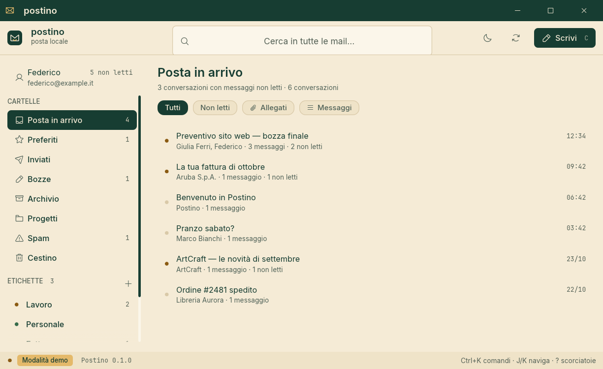
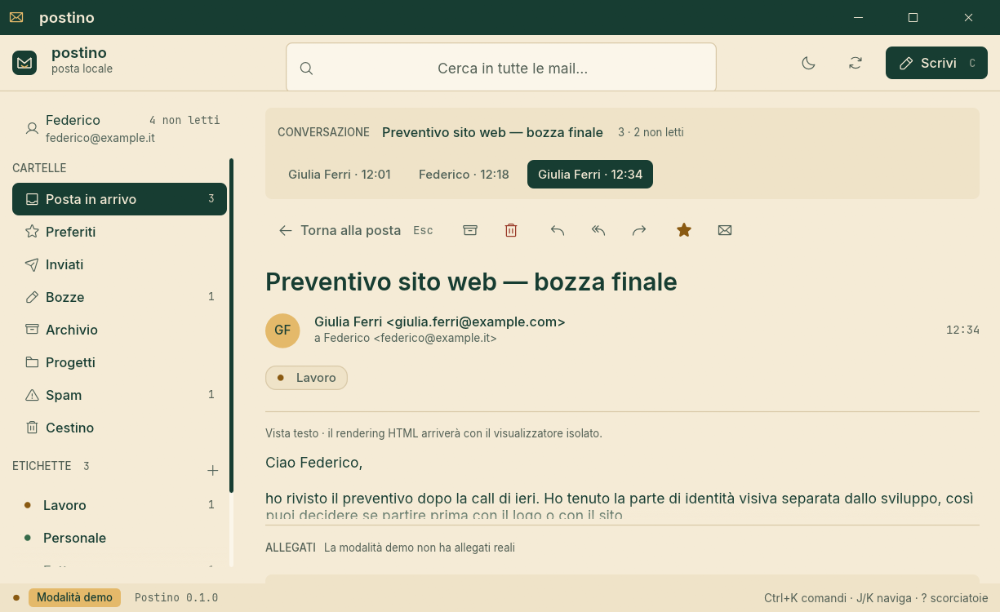
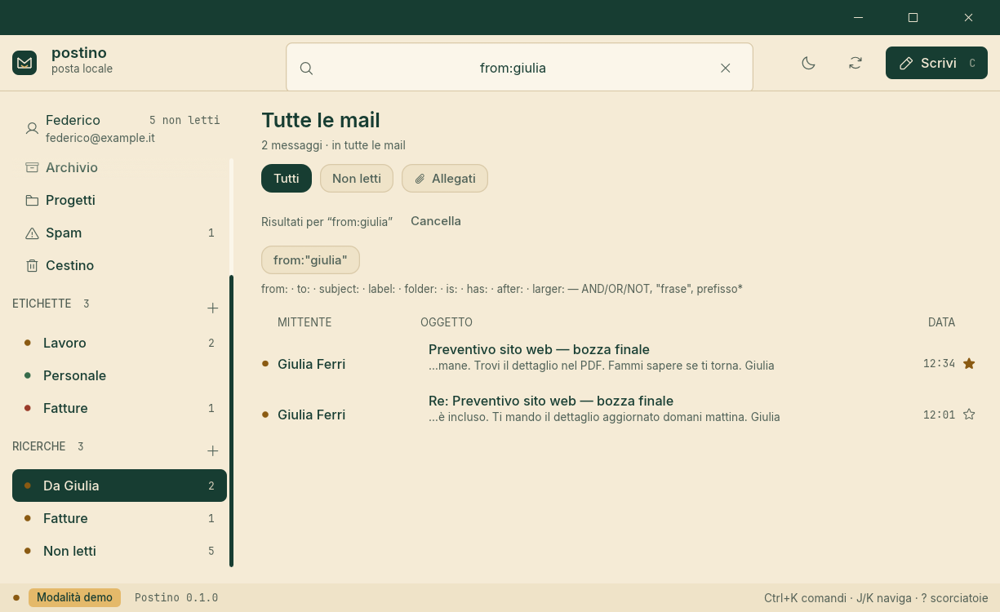
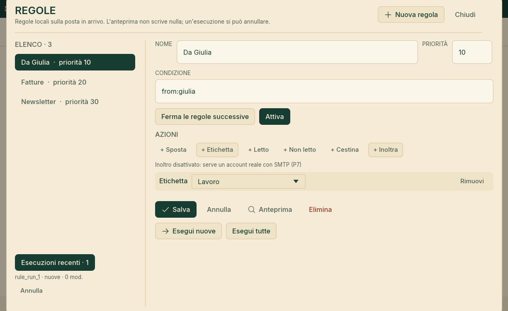
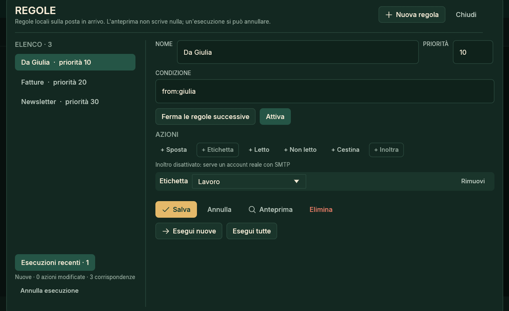
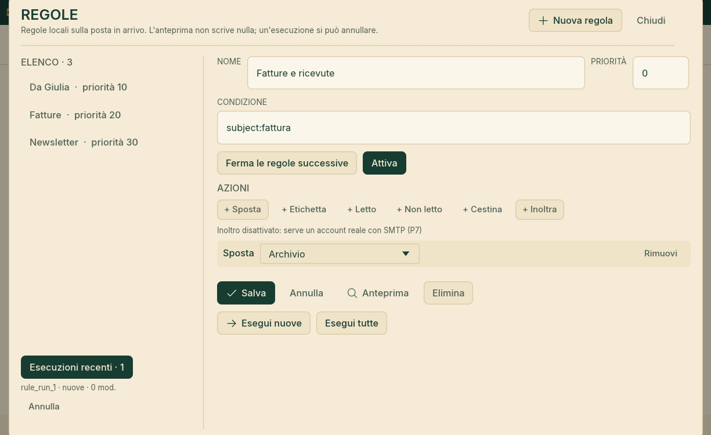
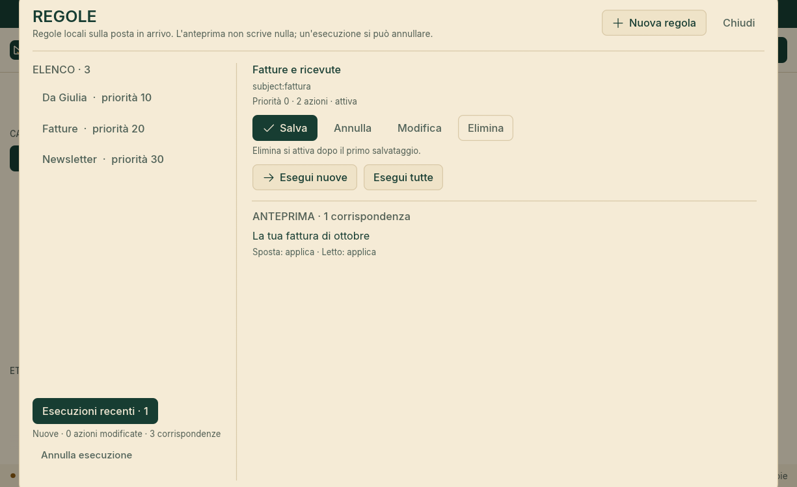
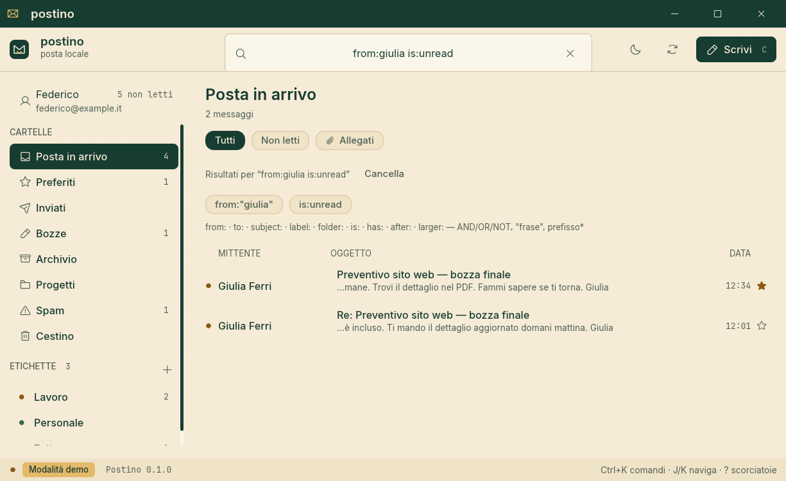

# Postino

**Local-first, agent-first mail.** A fast, native email client written in Rust, with one operation
registry shared by the desktop app, the CLI and an MCP server.

> **Status: Postino reads, searches, organizes and sends real mail, and its daemon owns the store.**
> M0, the U0 UI foundation and M1-M4 are complete on the encrypted store; M5 and M6 are in progress,
> with P13i (multiple senders) the latest merged phase. One Rust engine and one operation registry
> serve the desktop app, the CLI and the MCP server. See [ROADMAP.md](ROADMAP.md) for the current
> milestone.















```
Desktop  ─┐
CLI      ─┼──  one operation registry  ──  postino-core (Rust)
MCP      ─┘
```

## What M0 already does

- A native egui shell with the Postino palette: forest `#173D32`, ivory `#F5EBD6`, warm gold
  `#E4B96A`.
- Folder rail, message table, reading pane, filters, read/starred toggles, command palette
  (`Ctrl+K`), dark theme and a demo inbox with realistic threads and attachments.
- Compose window with To/Cc/Bcc, subject, a per-account plain-text signature, Markdown formatting,
  real attachments with their exact bytes (picker or drag-and-drop), autosaved drafts and
  reply/reply-all/forward prefill. The attachment row shows name, MIME, size and the running total;
  the caps are 20 files, 25 MiB per file and 25 MiB total. **Invia** is a real submission: the draft
  is queued with a 5-second undo window, the exact bytes are stored before any connection, and the
  outbox (`Ctrl+Shift+O`) shows queue, sending, uncertain, failed and Sent states. The demo has no
  store and no SMTP endpoint: **Allega file** is disabled with that reason and a stray drop reads
  nothing. `draft_save` is a patch on update: an omitted content field keeps the draft's current
  value, while an explicitly empty value clears it (the reply linkage is the one exception: P8 cannot
  clear it yet); `draft_attachment_add/remove` own the bytes and
  `draft_save` stays metadata-only. Reply drafts store the parent `Message-ID` and serialize
  `In-Reply-To`/`References`; reply-all uses `Reply-To`, removes the account's own address and never
  copies Bcc. A draft with a live journal row (`queued`, `sending`, `append_pending`, `uncertain` or
  `failed`) that belongs to a message still in Drafts cannot be edited or moved; a permanently failed
  row can be discarded from the outbox (CLI `postino outbox cancel`, or “Scarta”) to make the draft
  editable again, and a Sent copy is ordinary mail that can be moved or archived.
- Local labels with a semantic colour palette: create, rename and delete from the sidebar; apply and
  remove from the message menu (`L`), the command palette, the CLI and MCP; filter the list by label
  and see label chips in the reading pane. A label view spans every folder by default and a folder
  narrows it; ids are stable and never reused. Rename, delete and apply/remove are undoable in the
  app; creating a label is not an undo step. Labels are in-memory metadata until M1.
- A text reading pane with sender, recipients, Cc, date, subject and label chips, a quiet “Vista
  testo” note, and safe links. Only absolute `http`, `https` and `mailto` are clickable; the
  confirmation sheet keeps the full URL and, for a web link, names the domain as written (an ASCII
  host, or the Unicode spelling with a punycode warning when it is not ASCII); a `mailto:` names its
  explicit recipient and uses “client di posta”, not “browser”. Only **Apri** hands it to the system
  browser or mail client. Userinfo and `mailto:` recipient lists, Cc/Bcc, `attach` fields and unknown
  query fields are refused; a backslash authority is accepted only with a warning. No `javascript:`,
  `file:`, `data:`, `vbscript:` or relative target is ever a link.
- Attachment Save through the native Save dialog writes the exact blob bytes, warns before saving an
  executable or macro-enabled file (including a `.exe` chosen in the dialog), refuses to replace an
  existing file until confirmed, and reports a missing blob as a readable toast. In `--demo` Save is
  visibly disabled because the synthetic mailbox has no attachment bytes. Settings covers accounts
  (add, remove, active, last sync per account), appearance (light/dark/system, reduced motion,
  reading width), data (store and blob paths with a copy action, open the blob folder) and version,
  licences and shortcuts; every section fits 980×600 and returns focus to the account switcher on
  `Esc`.
- Typed operations with JSON Schemas: `app_info`, `accounts_list`, `account_add`,
  `account_update`, `account_test`, `account_remove`, `account_signature_set`, `sync_now`,
  `sync_status`, `folders_list`, `messages_list`, `message_get`, `message_export`, `message_import`,
  `folder_export_mbox`, `folder_import_mbox`, `message_unsubscribe`, `message_flag`, `message_move`,
  `draft_save`, `draft_attachment_add`, `draft_attachment_remove`, `message_send`, `send_schedule`,
  `outbox_list`, `outbox_cancel`, `outbox_retry`, `outbox_mark_sent`, `send_dry_run`, `search`,
  `search_status`, `search_reindex`, `threads_list`, `thread_get`, `thread_flag`,
  `saved_searches_list`, `saved_search_create`, `saved_search_update`, `saved_search_delete`,
  `saved_search_recent_clear`, `rules_list`, `rules_create`, `rules_update`, `rules_delete`,
  `rules_preview`, `rules_run`, `rules_undo`, `rules_runs`, `labels_list`, `label_create`,
  `label_update`, `label_delete`, `label_apply`, `templates_list`, `template_create`,
  `template_update`, `template_delete`, `identities_list`, `identity_create`, `identity_update`,
  `identity_delete`.
- **Conversations (P9b).** Thread ids come from the message's reference chain: an incoming
  `References`/`In-Reply-To` is normalised, bounded and resolved against the cached conversations; an
  unresolved reference becomes a phantom root waiting for its parent, two resolved threads merge into
  the smallest id and the old id stays as an alias. A late parent joins the children, a subject
  fallback attaches only a `Re:`/`Fwd:` message with a normalised subject of at least 8 bytes to
  exactly one thread within 14 days, and a duplicate `Message-ID` resolves through the smallest local
  id. Folder views list one row per conversation with participants, subject, date and mailbox-wide
  unread/starred/message counts; `/` search stays flat until **Conversazioni** in the palette turns it
  into grouped results. Opening a thread shows one expanded card, `J`/`K` move the open card,
  `Enter` opens it, `R`/`A`/`F` reply/reply-all/forward it, and `E`/`U`/`S` act on the whole thread
  with one undo. `threads_list`, `thread_get` and `thread_flag` are the operation surface; `thread_get`
  follows aliases and the cache is rebuilt by `search_reindex`.
- **Saved searches (P9b).** The sidebar's **RICERCHE** section (under ETICHETTE) saves up to 12 named
  queries per account with unique names ignoring case. Applying one replaces the query and clears the
  label filter; the query's `folder:` clause owns the scope, and a query without one is account-wide.
  `Esc` restores the previous query, folder, filters and view. Counts are computed and cached until
  the mailbox changes; a query whose label or folder was deleted is shown as invalid with the reason,
  not hidden. The last eight successful
  queries live in the encrypted `meta.recent_searches:<account>` table and appear as chips when the
  search field is focused and empty; “Cancella ricerche recenti” clears them. Rename, edit and delete
  are undoable, and `saved_searches_list` plus the four CRUD/recent operations expose the same surface
  to agents.
- **Gmail labels (P13e).** When the IMAP server advertises `X-GM-EXT-1`, sync reads
  `X-GM-LABELS` with each envelope and with the folder liveness scan. Gmail system labels (`\Inbox`,
  `\Sent`, …) stay folders; each custom label becomes a mailbox-wide local label shown as a chip and
  filterable with `messages_list --label`. The mapping is one-way and read-only: local
  create/rename/delete never pushes to Gmail. The sync remembers the ids it applied in encrypted
  `meta`, so a label removed on the server disappears locally without deleting a label the person
  applied by hand. Names are bounded to 48 characters and control/bidi characters are rejected; at
  most 64 labels per message and 200 labels in total are mapped, so a hostile server cannot mint an
  unbounded label set.
- **Unsubscribe (P13d).** The IMAP ingest records the sender's bounded RFC 2369/8058
  `List-Unsubscribe` targets, and `message_unsubscribe` classifies up to four `mailto`, `https` or
  `http` choices. The reading pane shows **Disiscriviti** only when a valid target exists: a
  `mailto:` choice opens an ordinary draft the person still reviews and sends, a web choice goes
  through the existing link confirmation, and an `http` target is labelled insecure. Nothing is
  posted in the background, even when the header declares One-Click; the CLI prints the same choices
  and the target list is deleted with its message.
- **Local templates (P13c).** Up to 20 named compose templates live in the encrypted `meta` table, so
  no schema migration is needed. Settings → **MODELLI** creates, edits and deletes them, and the
  composer's **Modelli** menu inserts a subject only when it is empty and appends the body after any
  text already written, never discarding it. `templates_list`, `template_create`, `template_update`
  and `template_delete` are the same registry surface for the CLI and MCP; the demo mailbox has no
  local store, so its template list is empty and the create button is disabled with a reason.
- **Multiple senders (P13i).** Up to 10 alternative From addresses per account live in the encrypted
  `meta` table, never in the schema and never on a server. Settings → **MITTENTI** creates, edits and
  deletes them; the composer's **Da** picker switches the sender and swaps its signature without
  touching unrelated text. `draft_save.from` accepts an identity id or address (omit to keep the
  stored sender), and each draft stores its chosen From. At send time the engine resolves that
  address against the account or a current identity and fails loudly instead of silently falling
  back; the provider still decides whether the alias may submit, and an SMTP rejection stays
  visible. The operations are `identities_list`, `identity_create`, `identity_update` and
  `identity_delete`.
- **Email-safe HTML composition (P13h).** The composer's **Testo/HTML** toggle compiles the same
  Markdown-like source into a table-based HTML part with inline CSS and a matching plain-text
  alternative; raw HTML is never accepted from the UI, CLI or MCP. In HTML mode the eye button opens
  a live preview of the exact compiled output without sending or storing anything. `draft_save` takes
  `body_format: "html" | "plain"` (omit to keep the current representation), the CLI uses
  `postino draft save --html` / `--plain`, and the engine recompiles compiler-owned drafts at send
  time so the two parts cannot drift. The source is capped at 1 MiB; links are absolute
  `http(s)`/`mailto` only, and the output carries no script, class, stylesheet, remote image or web
  font.
- **`.eml` export/import (P13f).** `message_export` returns an RFC 5322 file: the exact retained v9
  bytes for signed/encrypted mail, otherwise a reconstruction from the stored sanitized body and
  attachments and threading headers. `message_import` runs a chosen file through the same MIME and
  attachment bounds as a server fetch and stores it read in the account's local **Import** folder;
  importing a copy never moves or overwrites an existing message with the same Message-ID. Files are
  capped at 10 MiB each way so the base64 stays inside the daemon frame. The reading pane exports the
  selected message, the palette imports one `.eml`, and `postino export <id> --out` /
  `postino import <path>` expose the same operations without a window.
- **`.mbox` export/import (P13g).** `folder_export_mbox` writes a whole folder as a bounded mbox,
  and `folder_import_mbox` splits a Thunderbird-style archive before creating anything, so a file
  without a valid `From ` separator imports zero messages and leaves no half-built folder. A
  separator is accepted only when it also names a month, year and time and the following block has
  at least two headers, so prose such as `From the desk` is not a message and a damaged boundary is
  refused rather than merged; mboxrd `>From` quoting is removed on import and restored on export.
  Imports go to the named local folder (names are bounded, reuse a prior import, and refuse a server
  folder with the same name); duplicate Message-IDs stay copies, are marked read, and never move
  cached mail. Export counts rows it cannot rebuild in `skipped`; only a folder with no exportable
  message fails. Both directions are capped at 10 MiB and 2 000 messages so base64 stays inside the
  daemon frame.
  `postino export-mbox <folder> --out` / `postino import-mbox <path> --folder` expose the same
  operations without a window; `--force` writes through a sibling temporary file before replacing
  the destination.
- **Local rules (P9c).** The Rules page (Settings → **Regole locali**, or the palette commands
  **Regole locali**/**Nuova regola**) stores up to 100 rules per account on the encrypted v7 tables.
  A rule is a validated search query plus 1–5 actions: move to a folder, add a label, read/unread,
  trash, or forward to 1–10 addresses. Rules run by `priority ASC, id ASC`; **stop** makes later rules
  skip the messages this one matched. `new` (the default) processes received-origin mail ingested
  after the rule was created and not yet applied; a message whose action failed or was deferred stays
  pending for the next run. `all` reads up to 2 000 candidates per rule and keeps a per-rule cursor,
  so repeated runs advance through a larger backlog and wrap at the end. Drafts, Sent copies (even an
  archived one), Trash and outbox rows are never candidates. Actions apply immediately in rule order,
  a repeated action is a no-op, and a failing target is reported without stopping the later rules.
  **Anteprima** shows the first 20 matches with one `applica`/`già così`/`salta` effect per action and
  writes nothing; editing an existing rule uses its creation horizon, and a forward without SMTP is
  `salta`. Every real run is journaled with ids and booleans only (no subject, address or body), the
  newest 20 runs are kept, and **Annulla esecuzione** reverses move/label/read/trash only on messages
  still in the state the run left them (a star change also protects the message). A forward is one P7
  outbox row with the deterministic `rule:<rule>:<message>` key, a durable dedupe marker,
  `Auto-Submitted` and `X-Postino-Rule`; incoming mail with either header is skipped, and a run queues
  at most 50 new forwards, leaving the rest for the next run. The app disables forward with a visible
  reason when the account has no SMTP endpoint; MCP refuses `rules_run`, a forward payload, an
  enable-only update of a stored forward rule, and any forward reached by `sync_now` without
  `--allow-send`.
- **Encrypted search (P9a).** `search` runs on the FTS5 index inside SQLCipher, not over an in-memory
  body vector: `from:`, `to:`, `cc:`, `bcc:`, `subject:`, `label:`, `folder:`, `is:`, `has:`,
  `before:`/`after:`, `larger:`/`smaller:`, quoted phrases, `*` prefixes and uppercase `AND`/`OR`/`NOT`
  with parentheses. Hits are bm25-ranked with an exact global date/id tie-break (an auxiliary rank table
  keeps the order inside FTS before the page), snippets are plain text (≤240 characters, never HTML),
  and the total is exact up to 10 000 (`total_capped`). The index is contentless-delete, has no
  sidecar, rebuilds in resumable 500-row batches and is repairable with `search_reindex`;
  `search_status` reports readiness, row-id drift, last error and the size of the database plus WAL.
  `Engine::open` loads list rows, labels, attachment id/hash metadata and draft metadata only; bodies,
  HTML and full attachment rows are read on demand through `Engine::message(id)` (owned and cached).
  An index build never blocks open: the app builds batches in the background and shows the progress
  banner.
- Real accounts from the CLI: Aruba and Gmail are discovered offline (Gmail needs 2FA + an app
  password, or OAuth since P12a), `custom` takes host/port/TLS, a no-echo prompt or `--password-stdin` is the
  only way in, and MCP cannot add or remove an account. Passwords live in the OS keyring, never in
  the database, logs or tool output.
- `postino` CLI for humans and scripts, including friendly `draft save --send`, `label` and
  `postino run` for any operation.
- Opt-in MCP server over stdio: `postino mcp`. No port, no telemetry.
- The persistence foundation, now wired into the engine: an encrypted SQLCipher store with schema v7
  (the v5 outbox, the v6 remote-image count, the v7 search columns/index, the conversation cache,
  saved searches and the rule tables/journal), additive migrations and a typed repository
  (`postino-store`), plus
  the OS keyring seam (`postino-platform`). `Engine::open` loads summaries once, repairs orphan
  drafts, builds the conversation cache for a P9a store once, writes every mutation through in one
  transaction and keeps store errors categorised; the desktop app boots on the store, with `--demo`
  as the synthetic fallback.
- The M1 MIME foundation as a crate (`postino-mime`, P4a): bounded RFC 5322/2045 parsing with
  recorded warnings, an allowlist HTML sanitizer that removes remote images (counting the
  `http`/`https` ones), HTML-to-text, and deterministic RFC 5322 serialization with header-injection
  guards and `Bcc` kept in the envelope. It is wired into sync and the engine; the desktop reading
  pane renders the sanitized block model and reports the stored blocked-image count without loading
  anything.
- Encrypted attachment bytes (P4b): `postino-crypto` derives an HKDF-SHA256 `blob` subkey from the
  store key and seals bytes with XChaCha20-Poly1305; `postino-store` keeps each distinct attachment
  content once under `<db file>.blobs/<xx>/<hash>.blob` (BLAKE3 name, zstd only when it helps,
  authenticated dedup that heals a damaged file, bounded reads, atomic writes), and
  `attachments.blob_hash` finally points at something. The engine exposes `attachment_bytes` and
  `store_attachment_bytes`, with tests across a reopen; sync writes the bytes and the P6c reading
  pane reads them through `attachment_bytes` when a person saves or previews an attachment.
  `attachment_get` exposes the same exact bytes to the CLI and MCP; the reading pane previews text
  and images with bounds (64 KiB text, 2048 px and 32 MiB image decode), while Save always writes the
  complete file.
- The M1 network foundation as a crate (`postino-net`, P5a): an IMAP4rev1 client over implicit TLS
  or STARTTLS, with the operating system's certificate verifier and no way to switch verification
  off. It logs in with `AUTHENTICATE PLAIN` or `LOGIN`, lists folders with special-use and modified
  UTF-7 names, selects and examines, fetches envelopes and whole bodies with `BODY.PEEK[]` (never
  setting `\Seen`), stores flags by UID, runs one `IDLE` cycle and logs out. Every line, literal,
  command and response is bounded, the password is zeroised and redacted, and a scripted TLS server
  in `postino-testkit` proves each path, including a 54-case hostile corpus. Both the daemon's
  scheduler and the app drive it.
- The M1 synchronization crate (`postino-sync`, P5b): `sync_account` reconciles one IMAP account into
  one encrypted store. It lists folders once and maps RFC 6154 special-use (`\Inbox`, `\Sent`,
  `\Drafts`, `\Trash`, `\Junk`, `\Archive`, `\Flagged`), resets a folder when `UIDVALIDITY` changes,
  fetches only new UIDs in bounded windows, parses each body with `postino-mime`, stores attachment
  bytes through the encrypted blob seam only within the per-attachment limit, removes cached messages
  whose UID disappeared, applies server flags on first insert and reports later drift without
  overwriting local read/star state. One transaction per message and a cursor that advances only after
  commit make a crash or a cancellation resume without a gap. Runs are cancellable, bounded by
  `SyncLimits`, and leave a JSON status under `meta`. Tested against the scripted server (initial,
  incremental, UIDVALIDITY, deletion, flags, oversized attachments, three network-drop points,
  cancellation + reopen, `BODY.PEEK`-only and an offline read through `Engine::open`), with a
  2 000-message test in CI and 10 000 behind `POSTINO_SLOW_TESTS=1`. P6a wires it to `sync_now`, so
  the CLI (`postino sync run`) and MCP can run it on demand; P10a's daemon runs the same sync on an
  interval and after a manual request, with no parallel run for one account.
- **SMTP submission and the outbox (P7).** `postino-net` now also speaks SMTP over implicit TLS or
  STARTTLS: `EHLO`, `AUTH PLAIN`/`LOGIN`, `MAIL`/`RCPT`/`DATA`, `SIZE`, `8BITMIME`, `SMTPUTF8`, DSN,
  dot-stuffing, bounded lines/replies/messages and typed errors. Before the final `.`, a 4xx is
  transient and a 5xx is permanent; after it, every failure (a refusal, a timeout, a close or a
  malformed reply) is *uncertain* and never retried automatically. `message_send` serializes the draft,
  stores the exact bytes in the encrypted blob store and inserts an outbox row before the network. A
  worker stamps each row's `lease_at` when it claims that row (45 minutes, above the client's
  30-minute body budget, so a live transfer is never expired as a crash), retries transient failures
  with 30 s → 1 h backoff (eight attempts), stops an account on an auth failure, and copies accepted
  mail to the server's `\Sent` with `\Seen`. The append claim is stamped when the `250` arrives, not at
  the pass start, so a long submission cannot leave it backdated; it also has its own attempt counter,
  so a failed append backs off 30 s → 1 h without resubmitting the message, and two passes cannot
  append the same row. The outbox has a `draft_id`
  column and a partial unique index over every active state, so a draft can have at most one active
  row: a repeated `message_send` (even after a cancel) is one row and one SMTP delivery, and an edit
  after a cancel is a new revision. `last_error` is a fixed sentence (stage and code), never the
  server's text. A crash during `DATA` becomes `Invio incerto`, with “Segna come inviato” and “Riprova
  manualmente”, never an automatic retry. The CLI has `postino send --draft <id> [--at …]
  [--dry-run]` and `postino outbox list [--limit N] [--offset N] | cancel | retry | mark-sent`; a plain
  `postino send` waits the 5-second undo window and submits, while only a future `--at` leaves the row
  queued. MCP exposes the same tools but gates sending behind `postino mcp --allow-send` and only
  queues. The desktop app polls the store every two seconds, so a row queued by the CLI or MCP is sent
  when due, and reloads the mailbox when another process delivers a row, so the draft leaves Drafts and
  Sent is current. The journal keeps 30 days of terminal history and pages newest-first. A Sent copy
  moved back to Drafts must be edited before it can be sent again: the engine compares the draft
  revision with the sent envelope, so the crash window where the local move did not run cannot become a
  duplicate delivery, and a stale engine cannot overwrite a message another process already sent.
  The `Date` header is the draft's **last-saved instant**, not the send instant: that is what makes
  the dry run and the later send byte-identical, and it means a draft edited days ago and sent today
  carries that older date.
- **Compose depth (P8): attachment bytes, signatures and reply/forward headers.**
  `draft_attachment_add` decodes a bounded base64 payload (≤ 25 MiB), sanitizes the filename with the
  serializer's own rule (traversal, CR/LF/NUL, bidi controls and Windows device names are repaired or
  refused), derives the `type/subtype` from the extension table (a declared type is only a hint and
  must agree with that table), renames a duplicate to `name (2).ext`, and writes
  the bytes through the encrypted blob store before the draft row and revision in one transaction.
  `draft_attachment_remove` deletes the row; the deduplicated blob stays until a later GC. At most
  20 files, 25 MiB each and 25 MiB total; a missing or corrupt blob refuses `message_send` with the
  filename and keeps the draft. The desktop composer opens the injected rfd multi-file picker or
  accepts an egui drop, shows name/MIME/size and the Italian total, and refuses in the demo with a
  reason instead of a dead button. Each account owns a ≤ 4 KiB plain-text signature, edited in
  Settings → Account and inserted in new, reply and forward messages; changing it never rewrites an
  existing draft. Reply/reply-all/forward use the parent's `Reply-To`, remove the account's own
  addresses, never expose Bcc, prefix the subject once, quote deterministically in UTC and set
  `In-Reply-To`/`References` from the parent `Message-ID` (the parent id alone; P9a stores the full
  incoming chain for P9b). Forwarded attachments are copied through the blob store with their bytes; a
  missing source is reported and blocks the send. CLI `draft attach/detach` and MCP
  `draft_attachment_add` reach the same operation; MCP accepts bytes, never a path. The reply link uses
  the existing `drafts.in_reply_to`; the received `Reply-To` still rides the existing `meta` table, and
  v9 stores the incoming `In-Reply-To`/`References` that the thread view reads.
- Headless rendering tests of the shell, gallery, composer, label and search flows (980×600
  light/dark, including the parse error), the reading pane's link/attachment/settings paths with
  injected opener/saver recorders, operation-schema tests, MCP protocol tests, store round-trip tests
  at both the repository and engine level, the FTS5 migration/query/performance suites, and a
  twenty-newsletter HTML corpus that must keep its text, drop scripts/forms/iframes and never retain
  a remote image source. The corpus is wired into the cross-platform renderer workflow for Windows,
  Linux and macOS.


The last four captures were exported from a 1.25× scaled Windows host, so the PNGs are 1225×750 while
the layout and every headless test are 980×600. The P9b conversation and saved-search captures use the
same harness and physical size. The P9c rules list, editor and preview captures use the 980×600
review size in both themes. The composer still has no schedule control: scheduling is `postino
send --at` or `send_schedule` over MCP until the UI action lands.

Everything below the UI is headless and has no egui dependency.

## Quick start

Requires Rust 1.98 or newer.

```sh
# Desktop app (demo mailbox)
cargo run -p postino-app

# CLI
cargo run -p postino-cli -- --demo info
cargo run -p postino-cli -- --demo folders
cargo run -p postino-cli -- --demo messages --folder inbox --limit 5
cargo run -p postino-cli -- --demo read msg_001
cargo run -p postino-cli -- --demo search fattura
cargo run -p postino-cli -- --demo search "from:giulia is:unread" --sort date
cargo run -p postino-cli -- --demo search "subject:\"fattura 2026\" OR label:lbl_1"
cargo run -p postino-cli -- --demo threads --folder inbox
cargo run -p postino-cli -- --demo thread get thr_preventivo
cargo run -p postino-cli -- --demo thread flag thr_preventivo --read
cargo run -p postino-cli -- --demo saved create "Fatture" "label:Fatture" --sort date
cargo run -p postino-cli -- --demo saved list
cargo run -p postino-cli -- --demo saved recent-clear
cargo run -p postino-cli -- --demo rules create "Fatture" "subject:fattura" --action label:lbl_3 --action read --priority 10
cargo run -p postino-cli -- --demo rules preview "subject:fattura" --action label:lbl_3 --action read
cargo run -p postino-cli -- --demo rules run
cargo run -p postino-cli -- --demo rules runs
cargo run -p postino-cli -- --store "$env:TEMP\postino\mail.db" rules undo rule_run_1
cargo run -p postino-cli -- --store "$env:TEMP\postino\mail.db" search-status
cargo run -p postino-cli -- --store "$env:TEMP\postino\mail.db" search-reindex
cargo run -p postino-cli -- --demo run messages_list folder=inbox limit=2
cargo run -p postino-cli -- --demo draft save --to "Giulia <giulia.ferri@example.com>" --subject "Ciao" --body "Ci sentiamo domani."
cargo run -p postino-cli -- --demo label list
cargo run -p postino-cli -- --demo label create "Ufficio" --color forest
cargo run -p postino-cli -- --demo messages --label lbl_1
cargo run -p postino-cli -- --demo messages --label lbl_1 --folder sent
cargo run -p postino-cli -- --demo search preventivo --label lbl_1

# P8 on the encrypted store: attach a local path, detach by name or id, set a signature from stdin
cargo run -p postino-cli -- --store "$env:TEMP\postino\mail.db" draft attach draft_1 "C:\Users\me\relazione.pdf"
cargo run -p postino-cli -- --store "$env:TEMP\postino\mail.db" draft detach draft_1 "relazione.pdf"
Get-Content "C:\Users\me\firma.txt" -Raw | cargo run -p postino-cli -- --store "$env:TEMP\postino\mail.db" account signature acc_0123456789abcdef

# Encrypted local store: the same operations, persisted across restarts
cargo run -p postino-cli -- --store "$env:TEMP\postino\mail.db" info

# A real account: the password is prompted without echo (or pipe one line with --password-stdin)
cargo run -p postino-cli -- account add --provider aruba --email me@example.it --name "Federico"
cargo run -p postino-cli -- account list
cargo run -p postino-cli -- account update acc_0123456789abcdef --smtp-host smtp.example.com --smtp-port 465 --smtp-tls implicit
cargo run -p postino-cli -- account test acc_0123456789abcdef
cargo run -p postino-cli -- sync run
cargo run -p postino-cli -- sync status

# Real send (P7): dry run, queue now, schedule, inspect and cancel
cargo run -p postino-cli -- send --draft draft_1 --dry-run
cargo run -p postino-cli -- send --draft draft_1
cargo run -p postino-cli -- send --draft draft_1 --at "2026-10-27T09:00:00+01:00"
cargo run -p postino-cli -- outbox list
cargo run -p postino-cli -- outbox cancel ob_0123456789abcdef
cargo run -p postino-cli -- outbox retry ob_0123456789abcdef --yes

# MCP sending is off unless the server is started with the flag
cargo run -p postino-cli -- --store "$env:TEMP\postino\mail.db" mcp --allow-send
cargo run -p postino-cli -- account remove acc_0123456789abcdef --yes
```

The app is `postino-app`; the command is `postino`. The product name stays Postino.

Without `--store` and without `--demo`, the CLI uses the default encrypted store at
`%LOCALAPPDATA%\Postino\mail.db` on Windows and takes the key from the OS keyring (service
`postino`, scope `default`). **Windows is the only keyring backend in this build**: macOS and Linux
fail at the `postino-platform` seam with `PlatformError::Unsupported` until their native keychains
land with packaging, so there is no platform-equivalent default store yet. `--store` picks another
SQLCipher database; `--demo` and `--store` are mutually exclusive. First-run key creation is
serialised with `<app local data>/Postino/keyring.lock` and verified by reading the key back. An IMAP
credential is stored under `account:<id>:imap` and an optional separate SMTP credential under
`account:<id>:smtp` in the same keyring, never in the database; when no SMTP secret exists the IMAP
credential is used for submission. The CLI's prompt does not echo and there is no `--password`
argument. The app's sync and send workers open their own connections by design and the outbox lease
(one row, one owner, each claim stamped when it is taken, a conditional transition per write) makes
concurrent passes safe; still, do not copy or move the database while `postino` runs, and do not
expect two clients to behave as two independent mailboxes.

Read-only commands (`info`, `tools`, `schema`, `account list`, `account test`, `sync status`, mail
reads) never create a missing default store and never touch the keyring for it: they report that no
account is configured. An explicit `--store` on a read-only command must already exist, otherwise it
is a usage error. Mutations (`account add`, `sync run`, account removal, draft/label/flag writes) may
create the default store. Exit codes are 0 for success, 1 for an operation failure and 2 for a usage
error, including `OpError::InvalidArgs` (missing `--yes`, an invalid address/name/endpoint, an unknown
id) and malformed `postino run` arguments. The `add | test | list | remove` account commands,
`sync run | status`, `send` and the desktop onboarding all use the same encrypted store; Gmail OAuth
is P12a. Sending opens the account's SMTP server; a dry run never connects.

### Daemon (P10a/P10b)

The daemon is the one process allowed to write the store, run sync, the outbox scheduler, local rules,
the search-index batches and blob GC. It listens only on a per-user Windows named pipe or Unix domain
socket; it opens no TCP port and never talks to a cloud service.

```sh
# Build both binaries once: the CLI starts the daemon as its sibling.
cargo build -p postino-cli -p postino-daemon
cargo run -p postino-cli -- daemon status
cargo run -p postino-cli -- daemon start
cargo run -p postino-cli -- --store "$env:TEMP\postino\mail.db" draft save \
  --to "Giulia <giulia.ferri@example.com>" --subject "Ciao" --body "Ci sentiamo domani."
cargo run -p postino-cli -- daemon stop
```

While the daemon is running, every existing command is a client: the CLI reads the owner-only token
file, speaks JSON-RPC 2.0 over the local endpoint and prints the same results as before. A scheduled
`postino send --at …` now leaves the machine even when no app or CLI is connected. When the daemon is
absent, read-only commands use the local cache directly; a mutation **starts the daemon** (that is the
documented fallback) and never opens a second writer. `--in-process` is a diagnostic for a stopped
daemon; it is refused while the daemon owns the store. The desktop app is a daemon client (P10a2): it
opens the store read-only while the daemon owns the writer, sends every mutation through the same
client, reconnects after a restart and keeps its view state. The tray, autostart and notifications are
daemon-owned (P10b1), and the app's daemon settings, close-to-tray and activation are P10b2.

`daemon status` answers with version, pid, start instant, store root, endpoint kind, accounts syncing,
the next outbox wake, search-index state, the scheduler wake count and the last redacted error. The
token is never in argv, environment, logs or status.

### MCP

```sh
cargo run -p postino-cli -- --demo mcp
```

The server speaks newline-delimited JSON-RPC 2.0 on stdin/stdout, implements `initialize`,
`ping`, `tools/list` and `tools/call`, and stops at EOF. It is never started automatically, and it
opens no listening port. When a daemon is running, `postino mcp` reads the token file and becomes a
daemon client: tools, schemas and results are exactly the daemon's registry. When the daemon is
absent, reads use the local encrypted cache directly and every mutation returns a readable tool error
("il daemon non è in esecuzione…"); MCP never starts a background process. A mutation queued through
MCP is submitted by the daemon's scheduler, not by this process.
`postino mcp --allow-send` enables `message_send`, `send_schedule`, `outbox_retry`,
`outbox_mark_sent` and `rules_run`; without the flag those tools are listed as disabled with the
reason and refused. `rules_run` is gated because an enabled rule may forward, and a
`rules_create`/`rules_update` payload that contains a forward action is refused before the typed
parser runs; non-forward rule CRUD and `rules_preview` stay available. `outbox_list`, `outbox_cancel`
and `send_dry_run` also stay available: a dry run is read-only and a cancel discards a queued or
permanently failed row rather than sending one.

Example client configuration:

```json
{
  "mcpServers": {
    "postino": {
      "command": "postino",
      "args": ["--demo", "mcp"]
    }
  }
}
```

Without `--demo` and `--store`, `postino mcp` targets the default store. With no daemon it opens it
read-only and mutations fail readably; with a daemon every call goes through the local pipe. The tools
are the same registry as the CLI, but `account_add`, `account_update` and `account_remove` are marked
sensitive: they are absent from `tools/list` and refused by `tools/call`, so an agent can neither set
nor see a password and cannot create, reconfigure or remove an account. `accounts_list`,
`account_test`, `sync_now` and `sync_status` are available; none of their results contains a
credential. Sending is a separate, explicit opt-in: `postino mcp --allow-send`.

## Quality gates

```sh
cargo xtask ci
```

Runs `cargo fmt --check`, clippy with `-D warnings`, the test suite, the layering check and the
asset check. `cargo xtask layers` enforces that `postino-core` stays headless. `cargo xtask assets`
verifies every font and logo against `ATTRIBUTION.toml`; `cargo xtask assets --write` regenerates
`ATTRIBUTION.md`.

The separate security workflow runs `cargo deny check` and the libFuzzer targets in `fuzz/` on
Linux (120 s per target) and on Windows with MSVC AddressSanitizer. Local CI deliberately does not
build them: `cargo-fuzz` needs nightly and a sanitizer. On Windows, `pwsh -File fuzz/run-windows.ps1`
builds and runs the same targets natively once the VS C++ ASan components are installed. See
`fuzz/README.md`.

### Windows note

The repository currently builds with the GNU Rust toolchain, which needs `dlltool.exe` for the
Windows import libraries. `postino-store` also builds SQLCipher and OpenSSL from source, so it needs
MSYS2 `make` and `perl`. Add both MSYS2 folders to `PATH` and let `make` use every core:

```powershell
C:\msys64\usr\bin\pacman.exe -S make   # once
$env:PATH = "C:\msys64\mingw64\bin;C:\msys64\usr\bin;$env:PATH"
$env:MAKEFLAGS = "-j$env:NUMBER_OF_PROCESSORS"
cargo test --workspace
```

If `cargo test` says `error calling dlltool`, the MinGW folder is missing from `PATH`. A cold
SQLCipher/OpenSSL build takes ~4.5 min with `MAKEFLAGS` and ~14 min without; warm builds are seconds.
See `docs/store-spike.md`.

The MSVC toolchain builds the shipped payload. `.github/workflows/release.yml` uses it with a static
CRT (`+crt-static` in `.cargo/config.toml`), so a release needs no Visual C++ redistributable and
no MinGW DLLs. Local development stays on GNU; `installer\Build-Package.ps1` refuses a target that
does not match the host, so the two never mix in one package.

## Releases

Releases are cut by the pipeline, never by hand:

```powershell
# after bumping [workspace.package] version in Cargo.toml and committing
git push origin main:release
```

That push runs the full `ci.yml` gate, builds the MSVC payload, the per-user MSI and the portable
ZIP with `installer\Build-Package.ps1` and `Build-Msi.ps1`, proves them with
`installer\Test-Package.ps1`, and opens a **draft** GitHub Release with the tag `v<version>`. Publish
the draft in the UI when the checksum looks right; `update_check` only sees published releases.

The app checks that feed once at start. When the published version is newer, a banner names it and
offers one button; `update_install` downloads the MSI of that release, refuses it unless its SHA-256
matches the release's `SHA256SUMS.txt`, saves it under `%LOCALAPPDATA%\Postino\updates` and starts
`msiexec`. Nothing is downloaded or run without that press. The releases are unsigned for now:
Windows SmartScreen will warn on first run, and the checksum proves integrity, not authorship.

## Design

- **Engine-first.** Every feature is an operation with a typed request, a JSON Schema and an
  end-to-end test. The GUI is one client, not the centre.
- **Local-first.** Mail is cached, indexed and searched on the machine. No Postino account, no
  cloud, no telemetry.
- **Rust core.** The network, storage, MIME and security code is Rust. The egui shell is Rust too.
  HTML email rendering is isolated behind a trait; a sandboxed webview backend can be added for
  fidelity without letting a browser engine into the rest of the app.
- **Honest limits.** IMAP is the sync protocol; the server stays the source of truth. Avatars shown
  to recipients depend on BIMI or a signature, not on this client. Auto-reply and server-side
  filters are provider features. The reading pane renders the sanitized block model and never loads
  remote images. The MIME sanitizer removes remote images before storage
  and counts them; sync stores that count, `message_get` exposes it and the pane names it in Italian,
  never fetching or re-adding a URL. Compose attachments are real files in the encrypted store, not
  inline images or HTML: the caps are 20 files, 25 MiB each and 25 MiB total, unknown extensions are
  labeled `application/octet-stream`, and the composer generates no thumbnail. The reading pane has
  a bounded text/image preview sheet; other types explain that only Save is available. The signature is plain
  text (no HTML, images or tracking), belongs to the account or one alternate sender, is not a separate MIME part, and a
  provider-side signature is neither read nor synchronized. In `--demo` the synthetic attachments have
  no bytes and Save/attach/preview is disabled with that reason. A link reaches the system browser or
  mail client only after the confirmation sheet, and Save writes attachment bytes to the chosen path
  without opening the file. `postino attachment get <id> --out <file>` writes the same bytes from the
  CLI. The chosen path is a local trust boundary: the app sanitizes the suggested
  filename and re-classifies the chosen name, but does not canonicalize a symlink, reparse point or
  NTFS alternate data stream that the person selects. See
  [docs/product.md](docs/product.md).

## Documentation

- [Product](docs/product.md): vision, scope, non-goals, honest limits.
- [Architecture](docs/architecture.md): current M0 shape and the target design.
- [MCP](docs/mcp.md): the stdio server, tools and protocol.
- [Gmail OAuth](docs/oauth.md): BYO Desktop client, loopback redirect, Testing-mode expiry and the Gmail-only limits.
- [Threat model](docs/threat-model.md): what Postino protects and what it does not.
- [Security policy](SECURITY.md): how to report a vulnerability.
- [Design](docs/design.md): palette, contrast, type, logo.
- [Development](docs/development.md): toolchain, layout, testing.
- [Windows packaging](installer/README.md): per-user MSI, portable ZIP, signing and checksum
  verification.
- [Store spike](docs/store-spike.md): P3a encrypted-SQLite evaluation, numbers and decision.
- [Briefs](docs/briefs/): the package contracts, including P3c engine wiring.
- [Roadmap](ROADMAP.md): M0 to M6.
- [Decisions](docs/decisions/): UI, runtime, sync and daemon-dependency ADRs.

## Licence

MIT OR Apache-2.0. Fonts and logos are attributed in [ATTRIBUTION.md](ATTRIBUTION.md).

Postino is an independent project. It is not affiliated with any email provider.
