# Postino

**Local-first, agent-first mail.** A fast, native email client written in Rust, with one operation
registry shared by the desktop app, the CLI and an MCP server.

> **Status: M0 walking skeleton + U0 UI foundation + the engine on the encrypted store (P3c/P3d) +
> the MIME crate (P4a) + encrypted attachment blobs (P4b) + the IMAP client (P5a) + sync into the
> store (P5b/P5c) + accounts, credentials and sync operations (P6a) + onboarding and the app on real
> data (P6b) + the text reading pane, safe links, attachment Save and full settings (P6c) + SMTP
> submission and the outbox (P7) + compose depth: attachment bytes, per-account signatures and
> reply/forward headers (P8).** The desktop app opens the encrypted SQLCipher store by default,
> offers a guided Aruba/Gmail/custom onboarding with a real connection test and background sync, and
> reads cached mail offline; `--demo` keeps the synthetic mailbox for screenshots and trials. The CLI
> and the MCP server use the same operation registry: `postino --store <path>` (or the default
> `%LOCALAPPDATA%\Postino\mail.db` on Windows) runs the same operations on the encrypted database,
> and the CLI can add a real Aruba or Gmail account with an app password, test it, sync it and remove
> it. **Postino can now send real mail with real attachments:** the composer queues a draft, the exact
> RFC 5322 bytes (including every attachment byte) are stored before any network call, an outbox
> survives restarts, a 5-second undo window precedes the first attempt, and a Sent APPEND is retried
> independently of submission. The transaction never resubmits an uncertain message. Passwords live
> only in the OS keyring; **Windows Credential Manager is the only keyring backend in this build**,
> and macOS/Linux fail at the platform seam until their keychains land with packaging. MIME parsing,
> sanitization and serialization exist as `postino-mime`; `postino-net` is an IMAP4rev1 client and
> the SMTP submission client; and `postino-sync` reconciles one account into the encrypted store.
> Attachment bytes are encrypted at rest in a content-addressed blob directory next to the database.
> Gmail OAuth is P12 and the background daemon lands in M4; inline `cid:` images, HTML compose and
> server-side signatures are explicitly out of scope for M2.

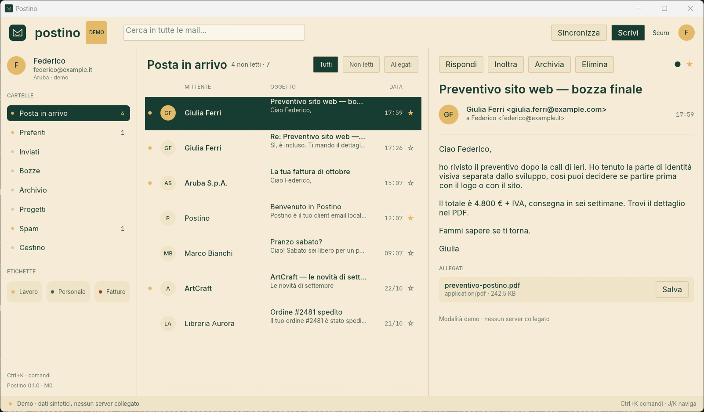

```
Desktop  ─┐
CLI      ─┼──  one operation registry  ──  postino-core (Rust)
MCP      ─┘
```

## What M0 already does

- A native egui shell with the Postino palette: forest `#173D32`, ivory `#F5EBD6`, warm gold
  `#E4B96A`.
- Folder rail, message table, reading pane, filters, read/starred toggles, command palette
  (`Ctrl+K`), dark theme and a demo inbox with realistic threads and attachments.
- Compose window with To/Cc/Bcc, subject, a per-account plain-text signature, Markdown formatting,
  real attachments with their exact bytes (picker or drag-and-drop), autosaved drafts and
  reply/reply-all/forward prefill. The attachment row shows name, MIME, size and the running total;
  the caps are 20 files, 25 MiB per file and 25 MiB total. **Invia** is a real submission: the draft
  is queued with a 5-second undo window, the exact bytes are stored before any connection, and the
  outbox (`Ctrl+Shift+O`) shows queue, sending, uncertain, failed and Sent states. The demo has no
  store and no SMTP endpoint: **Allega file** is disabled with that reason and a stray drop reads
  nothing. `draft_save` is a patch on update: an omitted content field keeps the draft's current
  value, while an explicitly empty value clears it (the reply linkage is the one exception: P8 cannot
  clear it yet); `draft_attachment_add/remove` own the bytes and
  `draft_save` stays metadata-only. Reply drafts store the parent `Message-ID` and serialize
  `In-Reply-To`/`References`; reply-all uses `Reply-To`, removes the account's own address and never
  copies Bcc. A draft with a live journal row (`queued`, `sending`, `append_pending`, `uncertain` or
  `failed`) that belongs to a message still in Drafts cannot be edited or moved; a permanently failed
  row can be discarded from the outbox (CLI `postino outbox cancel`, or “Scarta”) to make the draft
  editable again, and a Sent copy is ordinary mail that can be moved or archived.
- Local labels with a semantic colour palette: create, rename and delete from the sidebar; apply and
  remove from the message menu (`L`), the command palette, the CLI and MCP; filter the list by label
  and see label chips in the reading pane. A label view spans every folder by default and a folder
  narrows it; ids are stable and never reused. Rename, delete and apply/remove are undoable in the
  app; creating a label is not an undo step. Labels are in-memory metadata until M1.
- A text reading pane with sender, recipients, Cc, date, subject and label chips, a quiet “Vista
  testo” note, and safe links. Only absolute `http`, `https` and `mailto` are clickable; the
  confirmation sheet keeps the full URL and, for a web link, names the domain as written (an ASCII
  host, or the Unicode spelling with a punycode warning when it is not ASCII); a `mailto:` names its
  explicit recipient and uses “client di posta”, not “browser”. Only **Apri** hands it to the system
  browser or mail client. Userinfo and `mailto:` recipient lists, Cc/Bcc, `attach` fields and unknown
  query fields are refused; a backslash authority is accepted only with a warning. No `javascript:`,
  `file:`, `data:`, `vbscript:` or relative target is ever a link.
- Attachment Save through the native Save dialog writes the exact blob bytes, warns before saving an
  executable or macro-enabled file (including a `.exe` chosen in the dialog), refuses to replace an
  existing file until confirmed, and reports a missing blob as a readable toast. In `--demo` Save is
  visibly disabled because the synthetic mailbox has no attachment bytes. Settings covers accounts
  (add, remove, active, last sync per account), appearance (light/dark/system, reduced motion,
  reading width), data (store and blob paths with a copy action, open the blob folder) and version,
  licences and shortcuts; every section fits 980×600 and returns focus to the account switcher on
  `Esc`.
- Thirty typed operations with JSON Schemas: `app_info`, `accounts_list`, `account_add`,
  `account_update`, `account_test`, `account_remove`, `account_signature_set`, `sync_now`,
  `sync_status`, `folders_list`, `messages_list`, `message_get`, `message_flag`, `message_move`,
  `draft_save`, `draft_attachment_add`, `draft_attachment_remove`, `message_send`, `send_schedule`,
  `outbox_list`, `outbox_cancel`, `outbox_retry`, `outbox_mark_sent`, `send_dry_run`, `search`,
  `labels_list`, `label_create`, `label_update`, `label_delete`, `label_apply`.
- Real accounts from the CLI: Aruba and Gmail are discovered offline (Gmail needs 2FA + an app
  password; OAuth is P12), `custom` takes host/port/TLS, a no-echo prompt or `--password-stdin` is the
  only way in, and MCP cannot add or remove an account. Passwords live in the OS keyring, never in
  the database, logs or tool output.
- `postino` CLI for humans and scripts, including friendly `draft save --send`, `label` and
  `postino run` for any operation.
- Opt-in MCP server over stdio: `postino mcp`. No port, no telemetry.
- The persistence foundation, now wired into the engine: an encrypted SQLCipher store with schema v6
  (SMTP endpoints, the outbox journal and the stored remote-image count), additive migrations and a
  typed repository (`postino-store`), plus the OS keyring seam (`postino-platform`). `Engine::open`
  loads the mailbox once, repairs orphan drafts, writes every mutation through in one transaction
  and keeps store errors categorised; the desktop app boots on the store, with `--demo` as the
  synthetic fallback.
- The M1 MIME foundation as a crate (`postino-mime`, P4a): bounded RFC 5322/2045 parsing with
  recorded warnings, an allowlist HTML sanitizer that removes remote images (counting the
  `http`/`https` ones), HTML-to-text, and deterministic RFC 5322 serialization with header-injection
  guards and `Bcc` kept in the envelope. It is wired into sync and the engine; the desktop reading
  pane shows its text alternative, does not render HTML yet and reports the stored blocked-image
  count without loading anything.
- Encrypted attachment bytes (P4b): `postino-crypto` derives an HKDF-SHA256 `blob` subkey from the
  store key and seals bytes with XChaCha20-Poly1305; `postino-store` keeps each distinct attachment
  content once under `<db file>.blobs/<xx>/<hash>.blob` (BLAKE3 name, zstd only when it helps,
  authenticated dedup that heals a damaged file, bounded reads, atomic writes), and
  `attachments.blob_hash` finally points at something. The engine exposes `attachment_bytes` and
  `store_attachment_bytes`, with tests across a reopen; sync writes the bytes and the P6c reading
  pane reads them through `attachment_bytes` when a person saves an attachment.
- The M1 network foundation as a crate (`postino-net`, P5a): an IMAP4rev1 client over implicit TLS
  or STARTTLS, with the operating system's certificate verifier and no way to switch verification
  off. It logs in with `AUTHENTICATE PLAIN` or `LOGIN`, lists folders with special-use and modified
  UTF-7 names, selects and examines, fetches envelopes and whole bodies with `BODY.PEEK[]` (never
  setting `\Seen`), stores flags by UID, runs one `IDLE` cycle and logs out. Every line, literal,
  command and response is bounded, the password is zeroised and redacted, and a scripted TLS server
  in `postino-testkit` proves each path, including a 54-case hostile corpus. It is not wired into the
  app or a scheduler yet.
- The M1 synchronization crate (`postino-sync`, P5b): `sync_account` reconciles one IMAP account into
  one encrypted store. It lists folders once and maps RFC 6154 special-use (`\Inbox`, `\Sent`,
  `\Drafts`, `\Trash`, `\Junk`, `\Archive`, `\Flagged`), resets a folder when `UIDVALIDITY` changes,
  fetches only new UIDs in bounded windows, parses each body with `postino-mime`, stores attachment
  bytes through the encrypted blob seam only within the per-attachment limit, removes cached messages
  whose UID disappeared, applies server flags on first insert and reports later drift without
  overwriting local read/star state. One transaction per message and a cursor that advances only after
  commit make a crash or a cancellation resume without a gap. Runs are cancellable, bounded by
  `SyncLimits`, and leave a JSON status under `meta`. Tested against the scripted server (initial,
  incremental, UIDVALIDITY, deletion, flags, oversized attachments, three network-drop points,
  cancellation + reopen, `BODY.PEEK`-only and an offline read through `Engine::open`), with a
  2 000-message test in CI and 10 000 behind `POSTINO_SLOW_TESTS=1`. P6a wires it to `sync_now`, so
  the CLI (`postino sync run`) and MCP can run it on demand; there is still no scheduler or daemon.
- **SMTP submission and the outbox (P7).** `postino-net` now also speaks SMTP over implicit TLS or
  STARTTLS: `EHLO`, `AUTH PLAIN`/`LOGIN`, `MAIL`/`RCPT`/`DATA`, `SIZE`, `8BITMIME`, `SMTPUTF8`, DSN,
  dot-stuffing, bounded lines/replies/messages and typed errors. Before the final `.`, a 4xx is
  transient and a 5xx is permanent; after it, every failure (a refusal, a timeout, a close or a
  malformed reply) is *uncertain* and never retried automatically. `message_send` serializes the draft,
  stores the exact bytes in the encrypted blob store and inserts an outbox row before the network. A
  worker stamps each row's `lease_at` when it claims that row (45 minutes, above the client's
  30-minute body budget, so a live transfer is never expired as a crash), retries transient failures
  with 30 s → 1 h backoff (eight attempts), stops an account on an auth failure, and copies accepted
  mail to the server's `\Sent` with `\Seen`. The append claim is stamped when the `250` arrives, not at
  the pass start, so a long submission cannot leave it backdated; it also has its own attempt counter,
  so a failed append backs off 30 s → 1 h without resubmitting the message, and two passes cannot
  append the same row. The outbox has a `draft_id`
  column and a partial unique index over every active state, so a draft can have at most one active
  row: a repeated `message_send` (even after a cancel) is one row and one SMTP delivery, and an edit
  after a cancel is a new revision. `last_error` is a fixed sentence (stage and code), never the
  server's text. A crash during `DATA` becomes `Invio incerto`, with “Segna come inviato” and “Riprova
  manualmente”, never an automatic retry. The CLI has `postino send --draft <id> [--at …]
  [--dry-run]` and `postino outbox list [--limit N] [--offset N] | cancel | retry | mark-sent`; a plain
  `postino send` waits the 5-second undo window and submits, while only a future `--at` leaves the row
  queued. MCP exposes the same tools but gates sending behind `postino mcp --allow-send` and only
  queues. The desktop app polls the store every two seconds, so a row queued by the CLI or MCP is sent
  when due, and reloads the mailbox when another process delivers a row, so the draft leaves Drafts and
  Sent is current. The journal keeps 30 days of terminal history and pages newest-first. A Sent copy
  moved back to Drafts must be edited before it can be sent again: the engine compares the draft
  revision with the sent envelope, so the crash window where the local move did not run cannot become a
  duplicate delivery, and a stale engine cannot overwrite a message another process already sent.
  The `Date` header is the draft's **last-saved instant**, not the send instant: that is what makes
  the dry run and the later send byte-identical, and it means a draft edited days ago and sent today
  carries that older date.
- **Compose depth (P8): attachment bytes, signatures and reply/forward headers.**
  `draft_attachment_add` decodes a bounded base64 payload (≤ 25 MiB), sanitizes the filename with the
  serializer's own rule (traversal, CR/LF/NUL, bidi controls and Windows device names are repaired or
  refused), derives the `type/subtype` from the extension table (a declared type is only a hint and
  must agree with that table), renames a duplicate to `name (2).ext`, and writes
  the bytes through the encrypted blob store before the draft row and revision in one transaction.
  `draft_attachment_remove` deletes the row; the deduplicated blob stays until a later GC. At most
  20 files, 25 MiB each and 25 MiB total; a missing or corrupt blob refuses `message_send` with the
  filename and keeps the draft. The desktop composer opens the injected rfd multi-file picker or
  accepts an egui drop, shows name/MIME/size and the Italian total, and refuses in the demo with a
  reason instead of a dead button. Each account owns a ≤ 4 KiB plain-text signature, edited in
  Settings → Account and inserted in new, reply and forward messages; changing it never rewrites an
  existing draft. Reply/reply-all/forward use the parent's `Reply-To`, remove the account's own
  addresses, never expose Bcc, prefix the subject once, quote deterministically in UTC and set
  `In-Reply-To`/`References` from the parent `Message-ID` (the parent id alone until P9 carries the
  full chain). Forwarded attachments are copied through the blob store with their bytes; a missing
  source is reported and blocks the send. CLI `draft attach/detach` and MCP `draft_attachment_add`
  reach the same operation; MCP accepts bytes, never a path. No schema migration: the reply link uses
  the existing `drafts.in_reply_to` and the received `Reply-To` rides the existing `meta` table until
  P9 widens the message schema.
- Headless rendering tests of the shell, gallery, composer and label flows, the reading pane's
  link/attachment/settings paths with injected opener/saver recorders, operation-schema tests, MCP
  protocol tests, and store round-trip tests at both the repository and engine level.

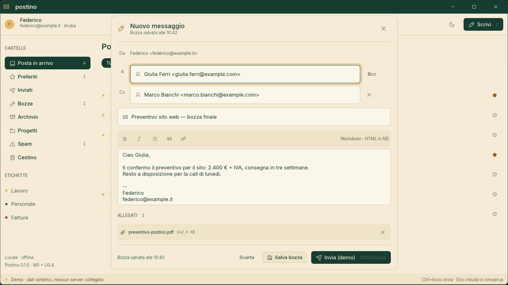

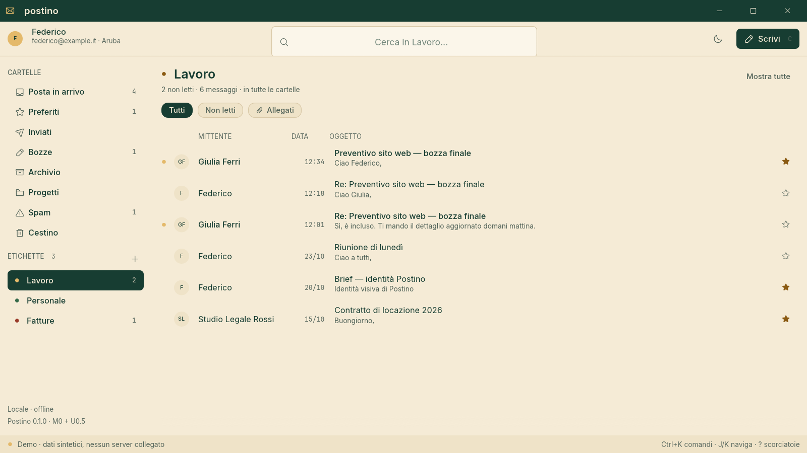

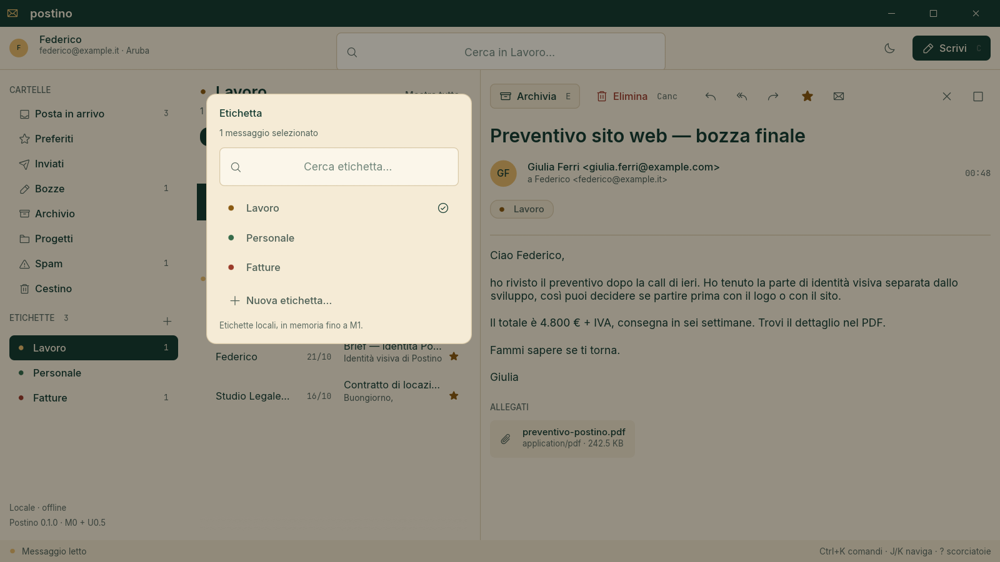

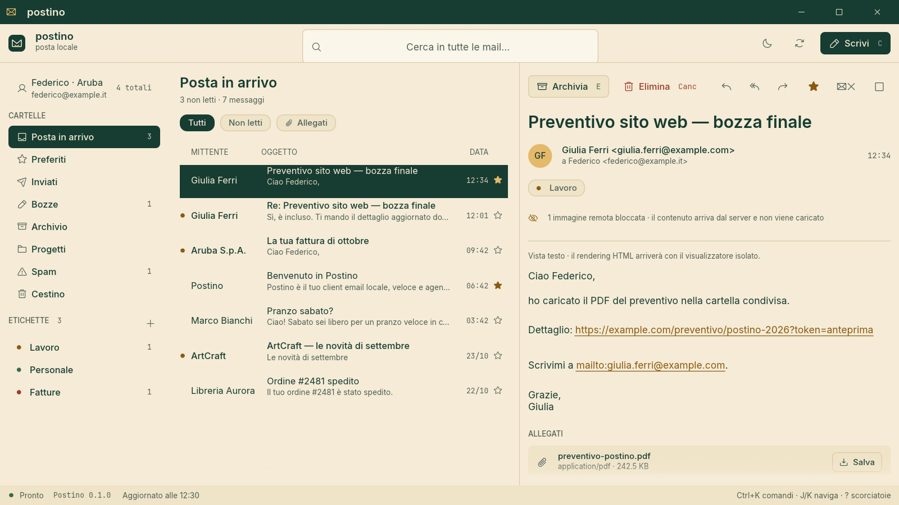

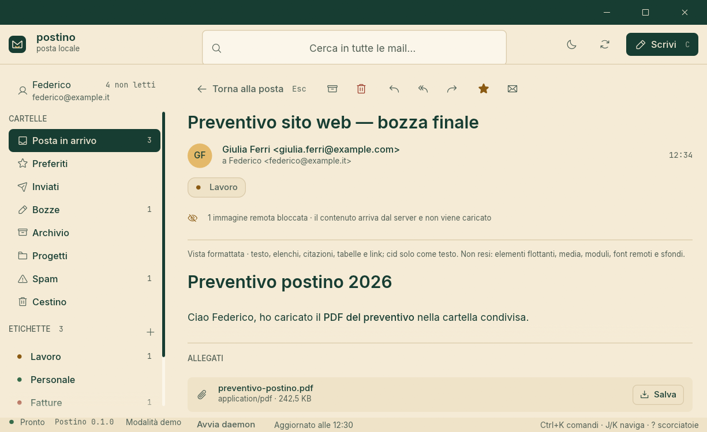

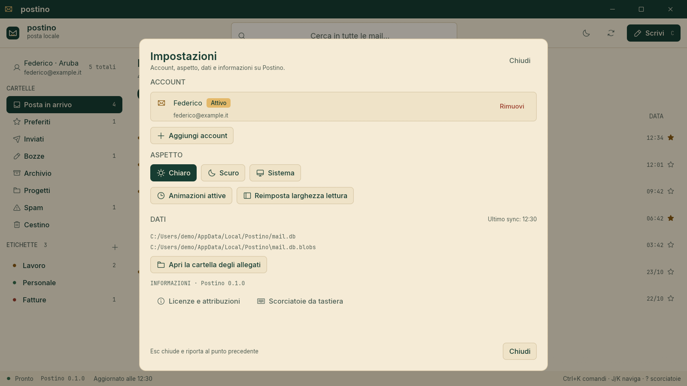

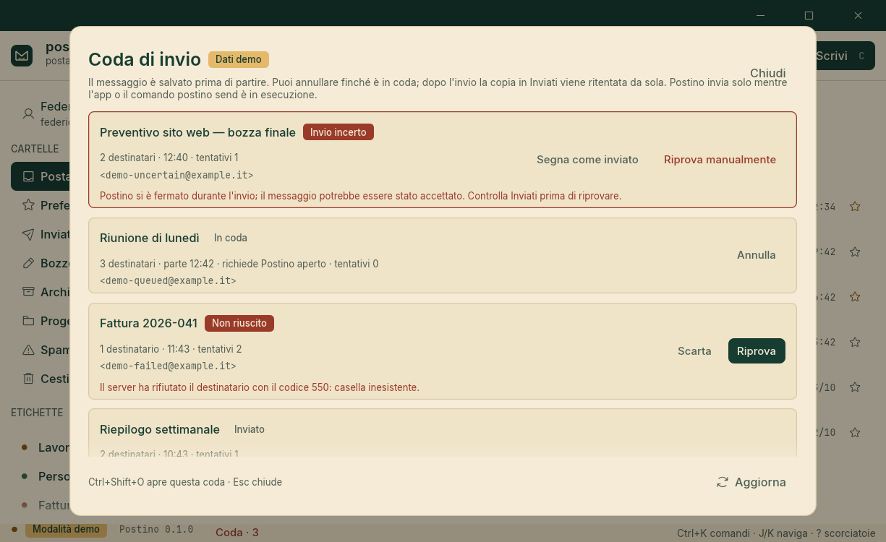

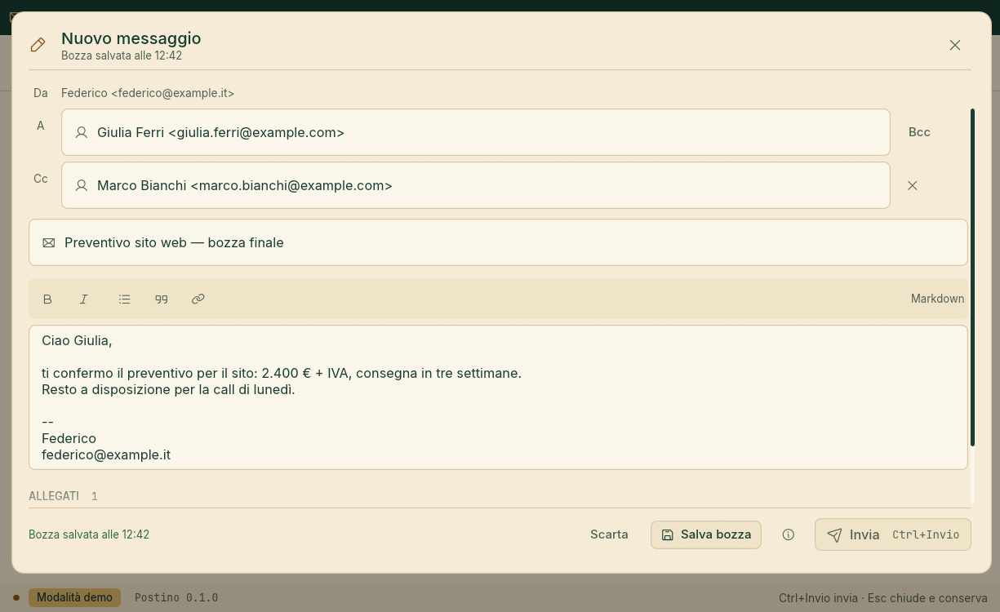

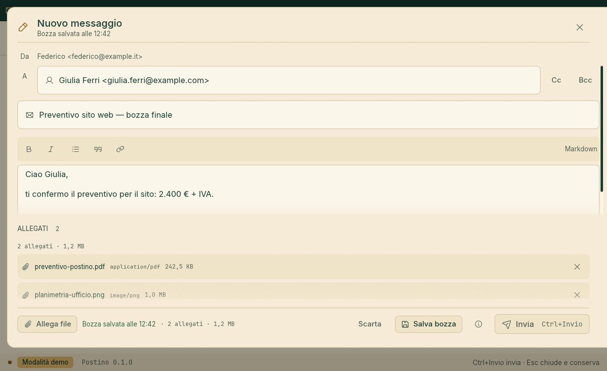

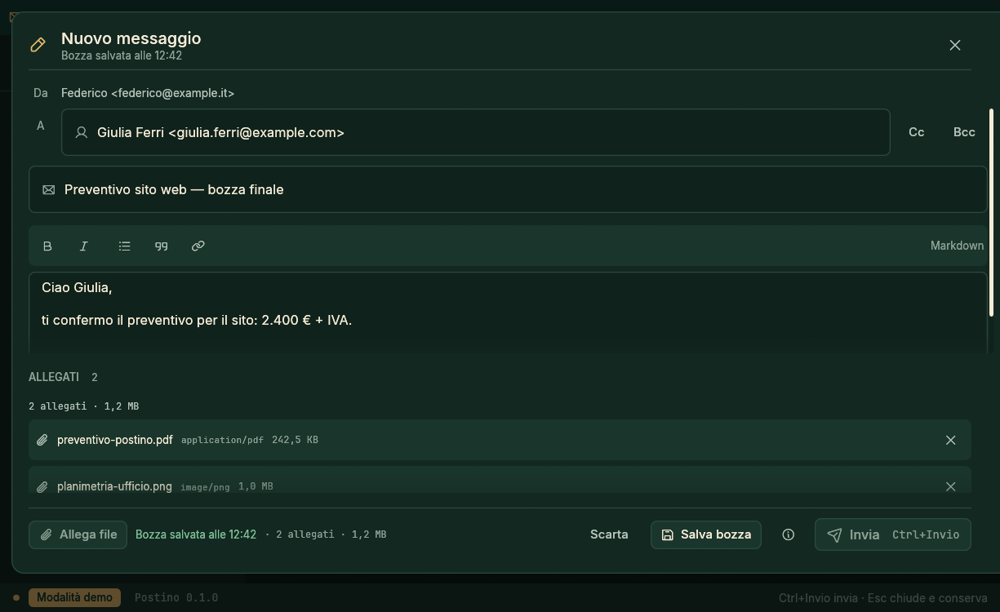

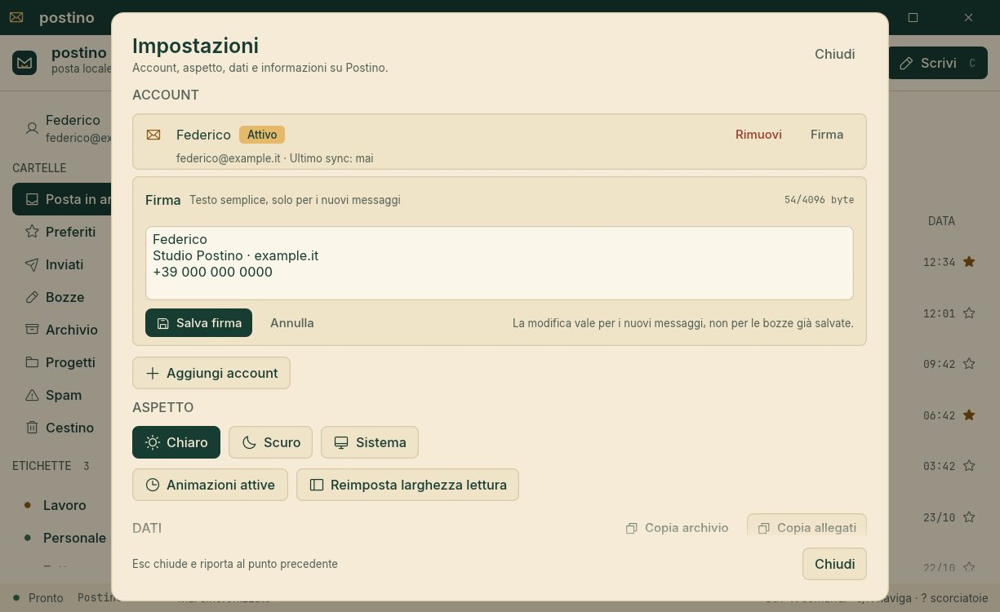

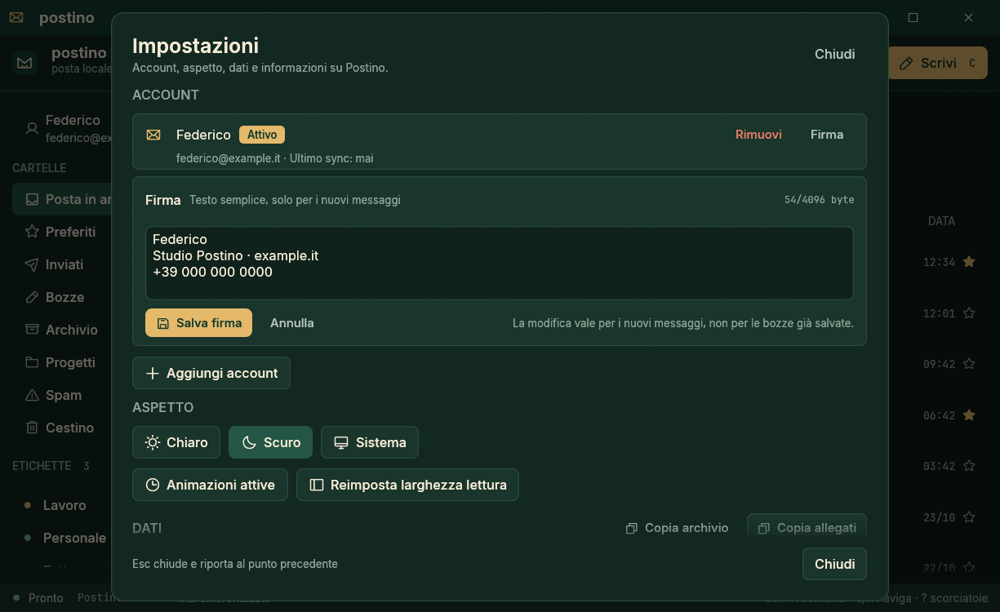

The last four captures were exported from a 1.25× scaled Windows host, so the PNGs are 1225×750 while
the layout and every headless test are 980×600. The composer still has no schedule control:
scheduling is `postino send --at` or `send_schedule` over MCP until the UI action lands.

Everything below the UI is headless and has no egui dependency.

## Quick start

Requires Rust 1.98 or newer.

```sh
# Desktop app (demo mailbox)
cargo run -p postino-app

# CLI
cargo run -p postino-cli -- --demo info
cargo run -p postino-cli -- --demo folders
cargo run -p postino-cli -- --demo messages --folder inbox --limit 5
cargo run -p postino-cli -- --demo read msg_001
cargo run -p postino-cli -- --demo search fattura
cargo run -p postino-cli -- --demo run messages_list folder=inbox limit=2
cargo run -p postino-cli -- --demo draft save --to "Giulia <giulia.ferri@example.com>" --subject "Ciao" --body "Ci sentiamo domani."
cargo run -p postino-cli -- --demo label list
cargo run -p postino-cli -- --demo label create "Ufficio" --color forest
cargo run -p postino-cli -- --demo messages --label lbl_1
cargo run -p postino-cli -- --demo messages --label lbl_1 --folder sent
cargo run -p postino-cli -- --demo search preventivo --label lbl_1

# P8 on the encrypted store: attach a local path, detach by name or id, set a signature from stdin
cargo run -p postino-cli -- --store "$env:TEMP\postino\mail.db" draft attach draft_1 "C:\Users\me\relazione.pdf"
cargo run -p postino-cli -- --store "$env:TEMP\postino\mail.db" draft detach draft_1 "relazione.pdf"
Get-Content "C:\Users\me\firma.txt" -Raw | cargo run -p postino-cli -- --store "$env:TEMP\postino\mail.db" account signature acc_0123456789abcdef

# Encrypted local store: the same operations, persisted across restarts
cargo run -p postino-cli -- --store "$env:TEMP\postino\mail.db" info

# A real account: the password is prompted without echo (or pipe one line with --password-stdin)
cargo run -p postino-cli -- account add --provider aruba --email me@example.it --name "Federico"
cargo run -p postino-cli -- account list
cargo run -p postino-cli -- account update acc_0123456789abcdef --smtp-host smtp.example.com --smtp-port 465 --smtp-tls implicit
cargo run -p postino-cli -- account test acc_0123456789abcdef
cargo run -p postino-cli -- sync run
cargo run -p postino-cli -- sync status

# Real send (P7): dry run, queue now, schedule, inspect and cancel
cargo run -p postino-cli -- send --draft draft_1 --dry-run
cargo run -p postino-cli -- send --draft draft_1
cargo run -p postino-cli -- send --draft draft_1 --at "2026-10-27T09:00:00+01:00"
cargo run -p postino-cli -- outbox list
cargo run -p postino-cli -- outbox cancel ob_0123456789abcdef
cargo run -p postino-cli -- outbox retry ob_0123456789abcdef --yes

# MCP sending is off unless the server is started with the flag
cargo run -p postino-cli -- --store "$env:TEMP\postino\mail.db" mcp --allow-send
cargo run -p postino-cli -- account remove acc_0123456789abcdef --yes
```

The app is `postino-app`; the command is `postino`. The product name stays Postino.

Without `--store` and without `--demo`, the CLI uses the default encrypted store at
`%LOCALAPPDATA%\Postino\mail.db` on Windows and takes the key from the OS keyring (service
`postino`, scope `default`). **Windows is the only keyring backend in this build**: macOS and Linux
fail at the `postino-platform` seam with `PlatformError::Unsupported` until their native keychains
land with packaging, so there is no platform-equivalent default store yet. `--store` picks another
SQLCipher database; `--demo` and `--store` are mutually exclusive. First-run key creation is
serialised with `<app local data>/Postino/keyring.lock` and verified by reading the key back. An IMAP
credential is stored under `account:<id>:imap` and an optional separate SMTP credential under
`account:<id>:smtp` in the same keyring, never in the database; when no SMTP secret exists the IMAP
credential is used for submission. The CLI's prompt does not echo and there is no `--password`
argument. The app's sync and send workers open their own connections by design and the outbox lease
(one row, one owner, each claim stamped when it is taken, a conditional transition per write) makes
concurrent passes safe; still, do not copy or move the database while `postino` runs, and do not
expect two clients to behave as two independent mailboxes.

Read-only commands (`info`, `tools`, `schema`, `account list`, `account test`, `sync status`, mail
reads) never create a missing default store and never touch the keyring for it: they report that no
account is configured. An explicit `--store` on a read-only command must already exist, otherwise it
is a usage error. Mutations (`account add`, `sync run`, account removal, draft/label/flag writes) may
create the default store. Exit codes are 0 for success, 1 for an operation failure and 2 for a usage
error, including `OpError::InvalidArgs` (missing `--yes`, an invalid address/name/endpoint, an unknown
id) and malformed `postino run` arguments. The `add | test | list | remove` account commands,
`sync run | status`, `send` and the desktop onboarding all use the same encrypted store; Gmail OAuth
is P12. Sending opens the account's SMTP server; a dry run never connects.

### MCP

```sh
cargo run -p postino-cli -- --demo mcp
```

The server speaks newline-delimited JSON-RPC 2.0 on stdin/stdout, implements `initialize`,
`ping`, `tools/list` and `tools/call`, and stops at EOF. It is never started automatically.
`postino mcp --allow-send` enables `message_send`, `send_schedule`, `outbox_retry` and
`outbox_mark_sent`; without the flag those tools are listed as disabled with the reason and refused.
`outbox_list`, `outbox_cancel` and `send_dry_run` stay available: a dry run is read-only and a cancel
discards a queued or permanently failed row rather than sending one. The MCP server never runs the
outbox pass — it only queues; the desktop app or `postino send` is what submits.

Example client configuration:

```json
{
  "mcpServers": {
    "postino": {
      "command": "postino",
      "args": ["--demo", "mcp"]
    }
  }
}
```

Without `--demo` and `--store`, `postino mcp` opens the default store. The tools are the same
registry as the CLI, but `account_add`, `account_update` and `account_remove` are marked sensitive:
they are absent from `tools/list` and refused by `tools/call`, so an agent can neither set nor see a
password and cannot create, reconfigure or remove an account. `accounts_list`, `account_test`,
`sync_now` and `sync_status` are available; none of their results contains a credential. Sending is a
separate, explicit opt-in: `postino mcp --allow-send`.

## Quality gates

```sh
cargo xtask ci
```

Runs `cargo fmt --check`, clippy with `-D warnings`, the test suite, the layering check and the
asset check. `cargo xtask layers` enforces that `postino-core` stays headless. `cargo xtask assets`
verifies every font and logo against `ATTRIBUTION.toml`; `cargo xtask assets --write` regenerates
`ATTRIBUTION.md`.

### Windows note

The repository currently builds with the GNU Rust toolchain, which needs `dlltool.exe` for the
Windows import libraries. `postino-store` also builds SQLCipher and OpenSSL from source, so it needs
MSYS2 `make` and `perl`. Add both MSYS2 folders to `PATH` and let `make` use every core:

```powershell
C:\msys64\usr\bin\pacman.exe -S make   # once
$env:PATH = "C:\msys64\mingw64\bin;C:\msys64\usr\bin;$env:PATH"
$env:MAKEFLAGS = "-j$env:NUMBER_OF_PROCESSORS"
cargo test --workspace
```

If `cargo test` says `error calling dlltool`, the MinGW folder is missing from `PATH`. A cold
SQLCipher/OpenSSL build takes ~4.5 min with `MAKEFLAGS` and ~14 min without; warm builds are seconds.
See `docs/store-spike.md`.

The MSVC toolchain is also installed on some machines, but it needs Visual Studio's `link.exe`.
The GNU toolchain plus MSYS2 is the path documented here.

## Design

- **Engine-first.** Every feature is an operation with a typed request, a JSON Schema and an
  end-to-end test. The GUI is one client, not the centre.
- **Local-first.** Mail is cached, indexed and searched on the machine. No Postino account, no
  cloud, no telemetry.
- **Rust core.** The network, storage, MIME and security code is Rust. The egui shell is Rust too.
  HTML email rendering is isolated behind a trait; a sandboxed webview backend can be added for
  fidelity without letting a browser engine into the rest of the app.
- **Honest limits.** IMAP is the sync protocol; the server stays the source of truth. Avatars shown
  to recipients depend on BIMI or a signature, not on this client. Auto-reply and server-side
  filters are provider features. The reading pane shows the plain-text alternative: it does not
  render HTML and never loads remote images. The MIME sanitizer removes remote images before storage
  and counts them; sync stores that count, `message_get` exposes it and the pane names it in Italian,
  never fetching or re-adding a URL. Compose attachments are real files in the encrypted store, not
  inline images or HTML: the caps are 20 files, 25 MiB each and 25 MiB total, unknown extensions are
  labeled `application/octet-stream`, and no thumbnail or preview is generated. The signature is plain
  text (no HTML, images or tracking), belongs to one identity, is not a separate MIME part, and a
  provider-side signature is neither read nor synchronized. In `--demo` the synthetic attachments have
  no bytes and Save/attach is disabled with that reason. A link reaches the system browser or mail
  client only after the confirmation sheet, and Save writes attachment bytes to the chosen path
  without opening the file. The chosen path is a local trust boundary: the app sanitizes the suggested
  filename and re-classifies the chosen name, but does not canonicalize a symlink, reparse point or
  NTFS alternate data stream that the person selects. See
  [docs/product.md](docs/product.md).

## Documentation

- [Product](docs/product.md): vision, scope, non-goals, honest limits.
- [Architecture](docs/architecture.md): current M0 shape and the target design.
- [MCP](docs/mcp.md): the stdio server, tools and protocol.
- [Threat model](docs/threat-model.md): what Postino protects and what it does not.
- [Security policy](SECURITY.md): how to report a vulnerability.
- [Design](docs/design.md): palette, contrast, type, logo.
- [Development](docs/development.md): toolchain, layout, testing.
- [Store spike](docs/store-spike.md): P3a encrypted-SQLite evaluation, numbers and decision.
- [Briefs](docs/briefs/): the package contracts, including P3c engine wiring.
- [Roadmap](ROADMAP.md): M0 to M6.
- [Decisions](docs/decisions/): UI, runtime and sync ADRs.

## Licence

MIT OR Apache-2.0. Fonts and logos are attributed in [ATTRIBUTION.md](ATTRIBUTION.md).

Postino is an independent project. It is not affiliated with any email provider.
